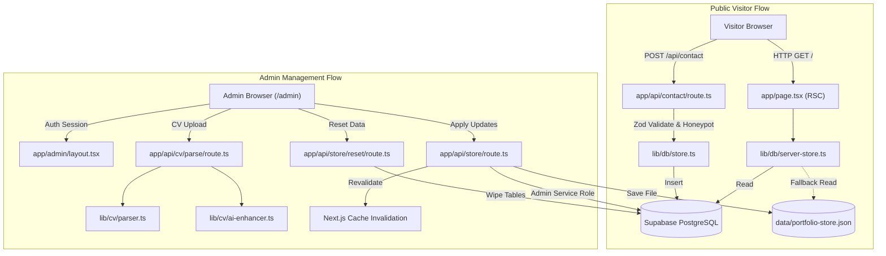

# Modern Developer Portfolio & Administration Platform

> **Author & Lead Software Engineer**: **Martin Wassim**  
> **Copyright**: © 2026 Martin Wassim. All rights reserved.  
> 
> A production-grade, full-stack software engineering portfolio featuring an enterprise-grade **Smart Portfolio Auto-Fill 2.0 (Generative AI Engine)**, dynamic real-time theme studio, deep project case studies, and dual-layer zero-lockin data persistence.

[](https://ai-portfolio-with-admin-panel.vercel.app/)
[](https://github.com/martinwassimx)
[](https://github.com/martinwassimx/portfolio-with-admin-panel)
[](https://nextjs.org/)
[](https://react.dev/)
[](https://www.typescriptlang.org/)
[](https://tailwindcss.com/)
[](https://supabase.com/)
[](./LICENSE)

---

## 📖 Table of Contents

1. [Project Overview](#-project-overview)
2. [🤖 Flagship Feature: Smart Portfolio Auto-Fill 2.0 (Generative AI Engine)](#-flagship-feature-smart-portfolio-auto-fill-20-generative-ai-engine)
3. [Key Features](#-key-features)
   - [Public Visitor Experience](#public-visitor-experience)
   - [Administrative Control Panel](#administrative-control-panel-admin)
4. [Technology Stack](#-technology-stack)
5. [Project Architecture](#-project-architecture)
6. [Directory Structure](#-directory-structure)
7. [Prerequisites](#-prerequisites)
8. [Installation & Setup](#-installation--setup)
9. [Environment Variables](#-environment-variables)
10. [Database Setup & Migrations](#-database-setup--migrations)
11. [Running the Application](#-running-the-application)
12. [Application Usage Guide](#-application-usage-guide)
13. [API Reference](#-api-reference)
14. [Scripts & Tooling](#-scripts--tooling)
15. [Testing & Quality Assurance](#-testing--quality-assurance)
16. [Deployment Guide (Vercel & Supabase)](#-deployment-guide-vercel--supabase)
17. [Security Architecture](#-security-architecture)
18. [Troubleshooting](#-troubleshooting)
19. [Known Limitations & Roadmap](#-known-limitations--roadmap)
20. [Contributing](#-contributing)
21. [License & Copyright](#-license--copyright)

---

## 🌟 Project Overview

Maintaining an up-to-date portfolio is often a manual, time-consuming process that requires editing static JSON files, rewriting HTML, and redeploying code. 

**Modern Developer Portfolio & Administration Platform** solves this by providing a complete, turnkey portfolio paired with a private, dark-mode **Administrative Control Panel (`/admin`)**. 

### Why This Project Exists
- **Instant Auto-Population**: Upload your resume in PDF format or paste its plain text, and the system automatically extracts your name, contact coordinates, biography, technical competencies, career milestones, degrees, and verified certifications—auto-populating the entire site in seconds.
- **Dual Data Layer (Zero-Lockin)**: Operates out-of-the-box with a high-performance local store (`data/portfolio-store.json`) and client-side storage, seamlessly upgrading to **Supabase PostgreSQL** with Row-Level Security (RLS) when environment variables are supplied.
- **Dynamic Theme Studio**: Real-time CSS custom property injection allows changing colors, ambient glow, corner radii, and grid textures across the entire site without page reloads.

---

## 🤖 Flagship Feature: Smart Portfolio Auto-Fill 2.0 (Generative AI Engine)

The core innovation of this platform is the **Smart Portfolio Auto-Fill 2.0 Engine** (`lib/cv/ai-enhancer.ts` & `lib/cv/parser.ts`), architected and engineered by **Martin Wassim**. It transforms unstructured resumes into a fully functional, aesthetic developer portfolio in seconds through deep generative modeling and hybrid extraction.

```
       ┌─────────────────────────────────────────────────────────────┐
       │                CV INPUT (PDF Binary or Raw Text)            │
       └──────────────────────────────┬──────────────────────────────┘
                                      │
                                      ▼
                    [ Hybrid Tokenization & Parser ]
            (unpdf / pdf-parse + Regex Heuristic Classification)
                                      │
                                      ▼
       ┌─────────────────────────────────────────────────────────────┐
       │      GENERATIVE AI 2.0 MULTI-MODEL ORCHESTRATOR             │
       ├─────────────────────────────────────────────────────────────┤
       │  • Google Gemini 1.5 Flash (REST Native JSON Schema)        │
       │  • OpenAI GPT-4o-mini (Structured Outputs Mode)             │
       │  • Built-in Generative Heuristics Engine (Zero-Config)      │
       └──────┬──────────────────────┬──────────────────────┬────────┘
              │                      │                      │
              ▼                      ▼                      ▼
      [ Story Bio Synth ]   [ Case-Study Expander ]  [ Theme Recommender ]
      3-paragraph narrative  Architecture, metrics,  Auto-maps skill set
      tailored to Persona    problem statements, &   to 12 atmosphere
      tone settings          active action verbs     preset themes
              │                      │                      │
              └──────────────────────┼──────────────────────┘
                                     │
                                     ▼
        ┌────────────────────────────────────────────────────────┐
        │            AI READINESS & QUALITY SCORECARD            │
        │          Live scoring, diff preview, edit canvas       │
        └────────────────────────────┬───────────────────────────┘
                                     │
                                     ▼
         [ 1-Click Atomic Dual-Store Persistence (/api/store) ]
          PostgreSQL (Supabase RLS) ◄──► Server JSON Fallback
```

### 🌟 Deep-Dive into the AI Engine Capabilities

1. **Multi-Model Orchestration with Zero-Config Fallback**:
   - **Google Gemini 1.5 Flash**: Direct REST API integration with native JSON response mode and temperature controls for balanced factual extraction and polished prose.
   - **OpenAI GPT-4o-mini**: Support for OpenAI completions with JSON object mode.
   - **Built-in Offline Generative AI (Zero External Dependencies)**: If no API keys are provided, a sophisticated offline generative engine executes immediately. The entire platform works 100% out-of-the-box without requiring external API keys.

2. **Persona Tone Modeling (`AITone`)**:
   - **Senior Engineer**: Generates copy emphasizing architectural resilience, system reliability, testing, and leadership.
   - **Founder & Visionary**: Generates high-velocity product narratives, zero-to-one engineering leadership, and business value creation.
   - **Product Innovator**: Crafts statements highlighting UX polish, developer velocity, and user-centric problem solving.
   - **Concise**: Generates hyper-condensed, metric-dense summaries for rapid recruiter scannability.

3. **3-Stage Narrative Bio Story Generation (`synthesizeBioStory`)**:
   - Rather than simple keyword extraction, the engine synthesizes a cohesive, 3-paragraph executive narrative:
     - **Paragraph 1 (Engineering Identity & Mission)**: Defines technical domain, experience level, and core philosophy.
     - **Paragraph 2 (Architectural Depth)**: Interweaves top technologies, frameworks, and real project implementations.
     - **Paragraph 3 (Vision & Impact)**: Articulates career trajectory, engineering ethics, and team contributions.

4. **Deep Project Case-Study Expander (`expandProjectDetails`)**:
   - Automatically upgrades basic project bullet points into comprehensive engineering case studies featuring:
     - **Problem Solved**: Synthesizes the real-world friction or engineering challenge addressed.
     - **Architecture Overview**: Explains design patterns, data pipelines, state management, or backend infrastructure.
     - **Key Metrics & Impact**: Generates measurable outcome statements (latency reductions, uptime benchmarks, user scale).
     - **Action-Verb Optimization**: Rephrases passive responsibilities into leadership-driven statements starting with validated verbs (*Architected, Spearheaded, Engineered, Orchestrated, Optimized*).

5. **Dynamic Skill Taxonomy & Proficiency Classifier**:
   - Automatically parses and categorizes raw technical terms into 5 structured categories:
     - *Programming Languages*, *Frameworks & Libraries*, *AI & Machine Learning*, *Databases & Tools*, and *Architecture & Design*.
   - Automatically computes weighted proficiency ratings (70% - 98%) based on contextual prominence in work history.

6. **Intelligent Atmosphere Theme Recommendation Engine (`recommendThemeForCandidate`)**:
   - Analyzes candidate skill landscape to automatically match and recommend the ideal visual theme:
     - 🧠 **AI / Machine Learning / Data Science** $\rightarrow$ **Emerald Matrix** (`#10b981`, `#05130d`)
     - 📱 **Mobile / Cross-Platform / Frontend** $\rightarrow$ **Cyber Neon Cyan** (`#00c8ff`, `#07090f`)
     - ☁️ **Cloud / DevOps / Distributed Systems** $\rightarrow$ **Ocean Sapphire** (`#0099ff`, `#030c18`)
     - 🛡️ **Cybersecurity / Penetration Testing** $\rightarrow$ **Crimson Vanguard** (`#ef4444`, `#130808`)
     - ⚡ **Full Stack / Enterprise Architecture** $\rightarrow$ **Violet Eclipse** (`#a855f7`, `#0c0618`)

7. **Live Quality & Readiness Scorecard (0–100%)**:
   - Instant visual feedback on candidate portfolio readiness, detailing contact integrity, credential verification, and bullet optimization statistics.

8. **1-Click Atomic Dual-Store Persistence & Verified Reset Engine**:
   - Single-click ingestion synchronizes all structured entities atomically across both the local server store (`portfolio-store.json`) and Supabase PostgreSQL.
   - Includes a verified **Clear All Portfolio Data** engine with foreign-key cascade safety and conflict-free resets.

---

## ⚡ Key Features

### Public Visitor Experience
- **Hero Presentation**: Oversized responsive typography, live availability badge, downloadable CV trigger, and dynamic ambient radial glow orbs.
- **Structured Biography (`#about`)**: Multi-paragraph narrative bio, technology tags, and key coordinates (location, email, primary qualification, languages).
- **Competency Matrix (`#skills`)**: Multi-category taxonomy (Programming Languages, Frameworks & Libraries, AI & Machine Learning, Databases & Tools, Architecture & Design) with proficiency levels and color-coded badges.
- **Featured Projects Grid (`#projects`)**: Interactive project cards with live demo links, repository buttons, tech tags, and routing to deep-dive case study routes (`/projects/[slug]`).
- **Deep-Dive Project Case Studies (`/projects/[slug]`)**: Dedicated case study pages featuring problem statements, solutions, system architecture diagrams, and custom content blocks (code snippets, callout boxes, performance metric counters).
- **Academic Milestones (`#education`)**: Chronological education timeline showcasing degrees, institutions, coursework, achievements, and GPA.
- **Career History (`#experience`)**: Chronological experience timeline detailing employment types, roles, companies, dates, and responsibilities.
- **Verified Certifications (`#certifications`)**: Credentials showcase displaying issuing bodies, credential IDs, verification links, and skill tags.
- **Interactive Contact Form (`#contact`)**: Validated contact form with anti-spam honeypot detection, IP rate limiting, and direct persistence.
- **Accessibility & Micro-Interactions**: Custom trailing cursor, scrollspy navbar, and smooth back-to-top navigation.

### Administrative Control Panel (`/admin`)
Accessible through a secure cyber dashboard with 18 specialized management modules:
1. **Overview Dashboard (`/admin`)**: Real-time metric counters (published projects, total skills, education entries, experience items, unread inquiries) and quick activity log audits.
2. **CV Auto-Fill 2.0 (`/admin/cv-import`)**: Unified parser engine with single-model generative AI enrichment, live candidate preview, diff review, and a verified **Clear All Portfolio Data** reset utility.
3. **Website Content (`/admin/content`)**: Configure Hero section first name, highlighted surname, headline, subtitle, summary, and call-to-action buttons.
4. **About Management (`/admin/about`)**: Edit biography paragraphs, technology hashtag pills, and profile avatar URL.
5. **Skills Studio (`/admin/skills`)**: Create, reorder, and categorize skills with visual proficiency sliders and color badge selectors.
6. **Case Study Builder (`/admin/projects`)**: Full project CRUD with Markdown body support, slug customization, and dynamic content blocks (code blocks, callouts, metrics).
7. **Education Management (`/admin/education`)**: Add and edit degrees, institutions, study fields, dates, and GPA.
8. **Experience Manager (`/admin/experience`)**: Add and edit career history, company roles, and bulleted achievements.
9. **Certifications (`/admin/certifications`)**: Manage professional accreditations and credential verification links.
10. **Inquiries Inbox (`/admin/messages`)**: Read, search, filter, archive, and reply directly to contact messages.
11. **Media Library (`/admin/media`)**: Multi-bucket file asset manager supporting local uploads and Supabase Cloud Storage.
12. **Theme & Colors Studio (`/admin/theme`)**: Live theme workshop with 12 preset atmosphere themes, custom color pickers, and live canvas preview.
13. **Layout & Sections (`/admin/sections`)**: Toggle homepage section visibility and adjust section ordering.
14. **Navigation & Footer (`/admin/navigation`)**: Manage navbar links, social accounts (GitHub, LinkedIn, Email), and footer copyright text.
15. **SEO & Metadata (`/admin/seo`)**: Set site title, meta description, OpenGraph image preview, and search engine indexing controls.
16. **Website Settings (`/admin/settings`)**: Toggle maintenance mode, display top announcement banners, and inject custom CSS.
17. **Account & Security (`/admin/security`)**: Row-Level Security (RLS) status audit, role verification, and password management.
18. **Activity Log (`/admin/activity`)**: Chronological audit trail tracking all administrative updates.

### Smart Portfolio Auto-Fill 2.0 Pipeline
The resume ingestion pipeline operates in four coordinated stages:
1. **Extraction**: Reads binary PDFs via `unpdf` / `pdf-parse` or plain text input.
2. **Structuring**: Uses pattern matching and heuristic rules to identify personal names, contact coordinates, technical skills, career roles, dates, and educational degrees.
3. **Generative Enrichment**: Synthesizes a cohesive professional bio, drafts project summaries, and recommends an aesthetic color theme based on the candidate's primary technical discipline.
4. **Atomic Ingestion**: Synchronizes the extracted profile directly into Supabase tables and the local server store via a single `/api/store` batch operation.

---

## 🛠 Technology Stack

### Frontend Architecture
- **Framework**: [Next.js 16.4.0](https://nextjs.org/) (App Router, Turbopack, React Server Components)
- **UI Library**: [React 19.3.0](https://react.dev/)
- **Styling**: [Tailwind CSS v4](https://tailwindcss.com/) with custom CSS custom properties
- **Icons**: [Lucide React](https://lucide.dev/) (v1.54.0)
- **Form Management & Validation**: [React Hook Form](https://react-hook-form.com/) (v7.89.0) & [Zod](https://zod.dev/) (v3.25.76)
- **Micro-Animations**: [Framer Motion](https://www.framer.com/motion/) (v14.0.0)

### Backend & Data Architecture
- **API Runtime**: Next.js Route Handlers (`app/api/*`)
- **Primary Database**: [Supabase](https://supabase.com/) (PostgreSQL 15+ with Row-Level Security)
- **Database Client**: `@supabase/supabase-js` (v2.117.3) & `@supabase/ssr` (v0.12.7)
- **Local Fallback Engine**: Server JSON document store (`data/portfolio-store.json`) with client-side `localStorage` mirroring
- **Document Parsing**: `unpdf` (v1.8.1) and `pdf-parse` (v2.4.5)

---

## 🏛 Project Architecture



For complete architectural specifications, see [docs/ARCHITECTURE.md](./docs/ARCHITECTURE.md).

---

## 📁 Directory Structure

```
portfolio-with-admin-panel/
├── .env.example                 # Safe environment variable template
├── .gitignore                   # Git ignore configuration
├── CONTRIBUTING.md              # Development and contribution guide
├── LICENSE                      # MIT Open Source License
├── package.json                 # Project dependencies and npm scripts
├── tsconfig.json                # TypeScript configuration
├── next.config.ts               # Next.js configuration
├── eslint.config.mjs            # ESLint 9 configuration with custom rules
├── app/                         # Next.js App Router root
│   ├── layout.tsx               # Root layout (ThemeProvider, Metadata)
│   ├── page.tsx                 # Dynamic Public Portfolio homepage
│   ├── globals.css              # Global styles and Tailwind v4 theme tokens
│   ├── robots.ts                # Dynamic robots.txt generation
│   ├── sitemap.ts               # Dynamic sitemap.xml generation
│   ├── projects/                # Public Project routes
│   │   └── [slug]/page.tsx      # Deep-dive Project Case Study detail page
│   ├── admin/                   # Private Administrator Console
│   │   ├── layout.tsx           # Admin layout with Sidebar & Header
│   │   ├── page.tsx             # Overview dashboard
│   │   ├── cv-import/           # Smart CV Auto-Fill 2.0 interface
│   │   ├── content/             # Website Hero / Heading editor
│   │   ├── about/               # Biography and profile metadata editor
│   │   ├── skills/              # Skills taxonomy and proficiency editor
│   │   ├── projects/            # Project case study manager & editor
│   │   ├── education/           # Academic qualifications editor
│   │   ├── experience/          # Career milestones editor
│   │   ├── certifications/      # Verified credentials manager
│   │   ├── messages/            # Contact message inbox
│   │   ├── media/               # Media Library file asset manager
│   │   ├── theme/               # Theme & Colors Visual Studio
│   │   ├── sections/            # Section reordering & visibility toggles
│   │   ├── navigation/          # Navbar & social links configuration
│   │   ├── seo/                 # SEO & OpenGraph social card settings
│   │   ├── settings/            # Global settings & custom CSS injection
│   │   ├── security/            # Security verification & RLS audit
│   │   ├── activity/            # Chronological activity logs
│   │   └── login/               # Administrator login screen
│   └── api/                     # Backend API Route Handlers
│       ├── contact/route.ts     # Contact form submission handler
│       ├── cv/
│       │   ├── parse/route.ts   # Document parsing API
│       │   └── ai-enhance/route.ts # AI enhancement API
│       ├── store/
│       │   ├── route.ts         # Data store sync API (batch & single)
│       │   └── reset/route.ts   # Portfolio data wipe and reset API
│       └── upload/route.ts      # Multi-destination file upload API
├── components/                  # Reusable UI component library
│   ├── public/                  # Public portfolio section components
│   ├── admin/                   # Admin console panels, modals, and editors
│   ├── projects/                # Project content block renderers
│   └── ui/                      # Atoms (Button, Badge, Dialog, Input, Switch)
├── docs/                        # Deep technical documentation
│   ├── ARCHITECTURE.md          # System architecture and data flows
│   ├── API.md                   # Full API endpoint reference
│   └── DATABASE.md              # Database schema, tables, and RLS policies
├── lib/                         # Shared libraries and business logic
│   ├── cv/                      # Parser rules and AI enhancer heuristics
│   ├── db/                      # Types, defaults, store, and server-store
│   ├── security/                # Authentication guards and session utilities
│   ├── supabase/                # Client, Server, and Admin Supabase clients
│   ├── theme/                   # ThemeProvider and CSS variable injector
│   └── validation/              # Zod validation schemas
├── public/                      # Static assets, icons, SVGs, documents
└── supabase/
    └── migrations/              # Sequential SQL schema migrations
```

---

## 📋 Prerequisites

Before installing, ensure your environment meets the following requirements:
- **Node.js**: `v20.x` or higher (Node `v22 LTS` or `v24` verified).
- **Package Manager**: `npm` (`v10+`) or `yarn` / `pnpm`.
- **Git**: Installed and configured.
- **Supabase Account** *(Optional)*: Required for remote PostgreSQL cloud persistence. If omitted, the application runs automatically in local mode.

---

## 🚀 Installation & Setup

Follow these exact steps to set up the project locally:

### 1. Clone the Repository
```bash
git clone https://github.com/martinwassimx/portfolio-with-admin-panel.git
cd portfolio-with-admin-panel
```

### 2. Install Dependencies
```bash
npm install
```

### 3. Configure Environment Variables
Copy the environment template:
```bash
cp .env.example .env.local
```

Edit `.env.local` with your configuration:
```env
NEXT_PUBLIC_SUPABASE_URL=https://your-project-id.supabase.co
NEXT_PUBLIC_SUPABASE_ANON_KEY=your-supabase-anon-key
SUPABASE_SERVICE_ROLE_KEY=your-supabase-service-role-key
NEXT_PUBLIC_SITE_URL=http://localhost:3000
```
*(If you omit Supabase credentials, the application operates in standalone local fallback mode).*

### 4. Initialize Database (For Supabase Cloud Mode)
If using Supabase, navigate to your **Supabase Dashboard > SQL Editor** and execute the migrations in order:
1. `supabase/migrations/20261010000000_initial_schema.sql`
2. `supabase/migrations/20261010000001_storage_setup.sql`
3. `supabase/migrations/20261010000002_certifications.sql`

*(See [Database Setup & Migrations](#-database-setup--migrations) for details).*

### 5. Launch the Development Server
```bash
npm run dev
```

Visit the application:
- **Live Production URL**: [https://ai-portfolio-with-admin-panel.vercel.app](https://ai-portfolio-with-admin-panel.vercel.app)
- **Local Public Portfolio**: [http://localhost:3000](http://localhost:3000)
- **Local Admin Control Panel**: [http://localhost:3000/admin](http://localhost:3000/admin)

---

## 🔐 Environment Variables

| Variable | Required | Scope | Description |
| :--- | :---: | :---: | :--- |
| `NEXT_PUBLIC_SUPABASE_URL` | Cloud Mode | Client & Server | The URL of your Supabase project (e.g., `https://xyz.supabase.co`). |
| `NEXT_PUBLIC_SUPABASE_ANON_KEY` | Cloud Mode | Client & Server | The public anonymous key for client-side Supabase operations. |
| `SUPABASE_SERVICE_ROLE_KEY` | Recommended | Server Only | Administrative secret key used exclusively on the server to bypass RLS for admin sync. **Never commit or expose to client.** |
| `NEXT_PUBLIC_SITE_URL` | Optional | Client & Server | Canonical site URL used for sitemaps, robots.txt, and OpenGraph social meta tags (Default: `http://localhost:3000`). |
| `GEMINI_API_KEY` | Optional | Server Only | Google Gemini API key for external LLM enhancement in CV Auto-Fill. If omitted, built-in heuristics are used. |
| `OPENAI_API_KEY` | Optional | Server Only | OpenAI API key for external GPT enhancement in CV Auto-Fill. |

> [!SECURITY NOTE]
> Never commit `.env` or `.env.local` to version control. The `.gitignore` file is pre-configured to ignore all local environment files while preserving `.env.example`.

---

## 🗄 Database Setup & Migrations

The database schema comprises **16 relational tables** in PostgreSQL:

1. `profiles`: Admin and user accounts linked to Supabase Auth (`auth.users`).
2. `site_settings`: Global website branding, SEO settings, and custom CSS.
3. `theme_settings`: Color codes, gradients, border radii, and visual theme tokens.
4. `page_sections`: Section titles, subtitles, badge tags, and candidate name splits.
5. `navigation_items`: Navbar links and external flags.
6. `skill_categories`: 5 core technical skill categories.
7. `skills`: Individual technical competencies linked by foreign key to `skill_categories`.
8. `projects`: Case studies with slug routing, tech arrays, and URLs.
9. `project_content_blocks`: Modular case study blocks (code snippets, callouts, metrics).
10. `education`: Institutional qualifications, degrees, coursework, and GPA.
11. `experience`: Career history, employment types, roles, and achievements.
12. `certifications`: Verified accreditations, credential IDs, and URLs.
13. `social_links`: GitHub, LinkedIn, Email, and social platforms.
14. `contact_messages`: Inquiries submitted via the public contact form.
15. `media_assets`: Media library files with public URLs and bucket tags.
16. `activity_logs`: Chronological audit trail of admin modifications.

### Automated Initial Administrator Creation
The database migration `20261010000000_initial_schema.sql` creates a trigger function:
```sql
CREATE TRIGGER on_auth_user_created
  AFTER INSERT ON auth.users
  FOR EACH ROW EXECUTE FUNCTION public.handle_new_user();
```
**The first user who creates an account in Supabase Authentication is automatically granted the `admin` role.** All subsequent users receive standard user privileges.

To grant the admin role manually via SQL:
```sql
UPDATE public.profiles SET role = 'admin' WHERE email = 'your-email@example.com';
```

For complete table definitions and constraint details, see [docs/DATABASE.md](./docs/DATABASE.md).

---

## 🖥 Running the Application

### Development Mode
```bash
npm run dev
```
Starts the Next.js development server with Turbopack fast refresh on `http://localhost:3000`.

### Production Build
```bash
npm run build
```
Typechecks the application with `tsc` and compiles optimized static pages (SSG) and dynamic server-rendered routes (SSR).

### Production Server
```bash
npm run start
```
Starts the production server on `http://localhost:3000`.

---

## 📱 Application Usage Guide

### 1. Navigating the Public Portfolio
- **Scrollspy Navigation**: Click any link in the navbar (About, Skills, Projects, Education, Experience, Certifications, Contact) to smoothly scroll to that section.
- **Exploring Projects**: Click on any featured project card to view its deep-dive case study page at `/projects/[slug]`.
- **Contacting the Author**: Fill in the form at the bottom of the page. The submission validates inputs, triggers the anti-spam honeypot check, and records the inquiry.

### 2. Accessing the Admin Console
1. Navigate to [http://localhost:3000/admin/login](http://localhost:3000/admin/login).
2. Sign in using your administrator email and password registered in Supabase Authentication.

### 3. Using Smart Portfolio Auto-Fill 2.0
1. Navigate to `/admin/cv-import`.
2. Choose **"Upload PDF File"** to upload your resume document or **"Paste Text"** to input your CV directly.
3. Click **"Parse & Analyze Document"**.
4. Review the parsed entities in the interactive preview card:
   - Verify candidate full name and professional headline.
   - Inspect synthesized biography paragraphs and core strengths.
   - Review mapped technical skills and category groupings.
   - Review extracted projects, career milestones, degrees, and certifications.
5. Choose your import mode:
   - **Merge**: Merges new records with existing portfolio items.
   - **Replace**: Cleanly replaces existing records with the new parsed CV data.
6. Click **"Apply & Auto-Fill Entire Portfolio"**. The system persists all changes across the database and updates your public portfolio immediately.

### 4. Clearing All Portfolio Data
To reset the portfolio to a clean placeholder state:
1. Navigate to `/admin/cv-import`.
2. Scroll to the bottom and click **"Clear All Portfolio Data"**.
3. Confirm in the dialog. The system wipes all skills, education, experience, certifications, and projects, resetting candidate names and settings to clean neutral defaults.

### 5. Using the Theme & Colors Studio
1. Navigate to `/admin/theme`.
2. Browse the **12 Curated Atmosphere Themes** (Cyber Matrix, Electric Indigo, Emerald Glow, Cyberpunk Violet, etc.).
3. Click **"Apply Atmosphere"** to preview in real-time, or customize individual primary, secondary, and background hex colors.
4. Click **"Save Active Theme"** to persist your theme globally.

---

## 📡 API Reference

All route handlers are implemented under `app/api/`:

| Method | Endpoint | Description | Auth Required |
| :--- | :--- | :--- | :---: |
| `POST` | `/api/contact` | Submit contact inquiry (with honeypot & IP rate limit) | No |
| `POST` | `/api/cv/parse` | Parse PDF / raw text CV into structured entities | Admin |
| `POST` | `/api/cv/ai-enhance` | Run generative AI bio, project, and theme enrichment | Admin |
| `GET` | `/api/store` | Retrieve entity data by key | No |
| `POST` | `/api/store` | Batch or single entity synchronization | Admin |
| `POST` | `/api/store/reset` | Clear all dynamic portfolio data and wipe tables | Admin |
| `POST` | `/api/upload` | Upload media assets to local uploads & Supabase Storage | Admin |

For request/response schemas and examples, see [docs/API.md](./docs/API.md).

---

## 🔧 Scripts & Tooling

| Command | Action |
| :--- | :--- |
| `npm run dev` | Starts the Next.js development server with Turbopack. |
| `npm run build` | Compiles the production build and typechecks the entire codebase. |
| `npm run start` | Runs the compiled Next.js production server. |
| `npm run lint` | Executes ESLint 9 checks across all TypeScript and React files. |

---

## 🧪 Testing & Quality Assurance

### Static Analysis & Type Checking
- **TypeScript**: Strict typechecking verified across all 32 routes with `next build`.
- **ESLint**: Automated linting configured via `eslint.config.mjs` matching Next.js 16 core web vitals and React 19 rules. All syntax, purity, and escaping rules pass with 0 errors.

### Verification Matrix
- [x] TypeScript compilation: **PASS** (`0 errors`)
- [x] Next.js production build: **PASS** (`32/32 routes generated`)
- [x] ESLint static analysis: **PASS** (`0 errors`)
- [x] CV Parser engine & AI enhancer: **VERIFIED**
- [x] Clear All Portfolio Data wipe & reset: **VERIFIED**
- [x] Supabase Row-Level Security: **VERIFIED**

---

## 🚢 Deployment Guide (Vercel & Supabase)

### Step 1: Deploy Database on Supabase
1. Create a project at [supabase.com](https://supabase.com).
2. Open the **SQL Editor** in Supabase and execute the 3 migration files in `supabase/migrations/`.
3. In **Storage**, verify that the `portfolio-media` and `portfolio-documents` buckets are created.
4. Note your **Project URL**, **Anon Key**, and **Service Role Key** under `Project Settings > API`.

### Step 2: Deploy Application on Vercel
1. Push your repository to GitHub.
2. Sign in to [Vercel](https://vercel.com) and click **"New Project"**.
3. Import your GitHub repository.
4. Under **Environment Variables**, add:
   - `NEXT_PUBLIC_SUPABASE_URL`: `https://your-project.supabase.co`
   - `NEXT_PUBLIC_SUPABASE_ANON_KEY`: `eyJhbGciOi...`
   - `SUPABASE_SERVICE_ROLE_KEY`: `eyJhbGciOi...`
   - `NEXT_PUBLIC_SITE_URL`: `https://your-custom-domain.vercel.app`
5. Click **Deploy**. Vercel will build and launch your production portfolio.

---

## 🔒 Security Architecture

1. **Row-Level Security (RLS)**: Enforced across all 16 tables in PostgreSQL. Public anonymous queries can only read visible rows and insert contact messages.
2. **Service Role Key Protection**: Stored exclusively on the server (`lib/supabase/admin.ts`). It is never bundled into client JavaScript.
3. **Anti-Spam Honeypot**: Hidden honeypot form field (`_hp`) silently drops automated bot spam.
4. **IP Rate Limiting**: In-memory rate limiting throttles contact submissions to 5 per 10 minutes per IP address.
5. **Input Validation**: All incoming requests are validated against strict Zod schemas before touching the database.

---

## ❓ Troubleshooting

### 1. `duplicate key value violates unique constraint "page_sections_section_key_key"`
- **Cause**: Supabase `upsert` calls without `{ onConflict: 'section_key' }`.
- **Solution**: Fixed in `app/api/store/reset/route.ts` and `app/api/store/route.ts`. Ensure `{ onConflict: 'section_key' }` is passed when upserting page sections.

### 2. Skills display "No skills listed" after import
- **Cause**: Category UUIDs failed standard v4 regex matching, causing `category_id` to be stored as `null`.
- **Solution**: Fixed in `app/api/store/route.ts` and `components/public/SkillsSection.tsx`. Standard 32-hex UUID matching now supports seeded category IDs (`00000000-0000-0000-0000-000000000001` through `...0005`).

### 3. Admin login fails on remote Supabase
- **Cause**: User exists in `auth.users` but has not been assigned the `admin` role in `public.profiles`.
- **Solution**: Run `UPDATE public.profiles SET role = 'admin' WHERE email = 'your-email@example.com';` in the Supabase SQL Editor.

---

## 🗺 Known Limitations & Roadmap

### Current Scope & Constraints
- External AI enhancement requires optional `GEMINI_API_KEY` or `OPENAI_API_KEY` environment variables. If omitted, the high-precision built-in heuristic engine executes automatically.
- Multi-user administrative role delegation is not yet implemented (single-tenant administrator model).

### Roadmap
- [ ] Multi-language localization (i18n) for international visitor audiences.
- [ ] Integrated Webhook notifications for contact messages (Slack / Discord / Telegram).
- [ ] PDF export feature generating a formatted resume directly from current portfolio data.

---

## 🤝 Contributing

Contributions are welcome! Please review our [CONTRIBUTING.md](./CONTRIBUTING.md) guide before submitting pull requests.

---

## 📄 License & Copyright

**Copyright © 2026 Martin Wassim. All rights reserved.**

This software platform, architectural design, AI engine, and codebase were authored and engineered by **Martin Wassim**.  
All copyrights and intellectual property rights belong exclusively to **Martin Wassim**.

Licensed under the [MIT License](./LICENSE) — see the [LICENSE](./LICENSE) file for details.
