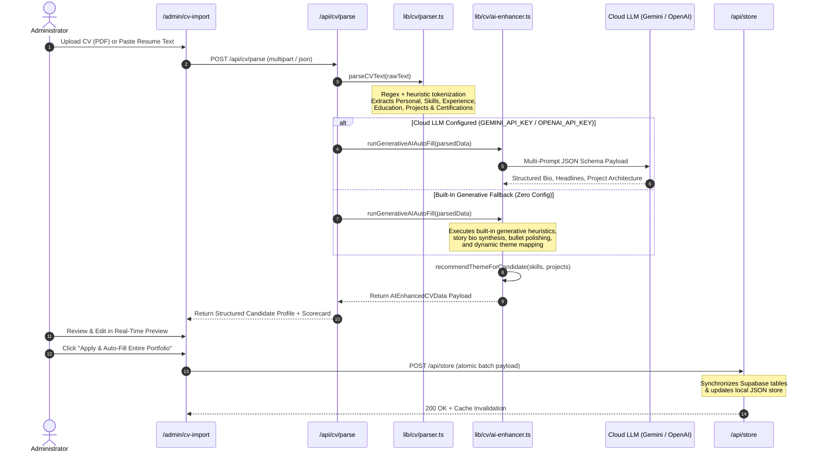

# System Architecture & Technical Design

> **Author & Lead Software Engineer**: **Martin Wassim**  
> **Copyright**: © 2026 Martin Wassim. All rights reserved.  
> 
> This document details the architectural design, component interactions, data flow, Generative AI pipeline, and security mechanisms of the **Portfolio with Admin Panel** application authored by Martin Wassim.

---

## 1. High-Level Architecture Overview

The system is built as a unified full-stack application using **Next.js 16 (App Router)** and **React 19**, backed by a **hybrid dual-layer data architecture**:

1. **Remote Cloud Layer (Primary Production)**: **Supabase** (PostgreSQL 15+) with Row-Level Security (RLS) and Supabase Storage.
2. **Local Fallback Engine (Zero-Config / Offline / Demo Mode)**: An in-memory and local JSON file persistence layer (`data/portfolio-store.json`) with client-side `localStorage` mirroring.

This hybrid model guarantees that the portfolio functions immediately upon cloning without requiring external services, while seamlessly upgrading to cloud persistence when Supabase credentials are provided.

```mermaid
graph TD
    subgraph Client ["Client Browser"]
        PV["Public Visitor UI (SSR / ISR)"]
        AC["Admin Console (/admin)"]
        TP["ThemeProvider (CSS Vars)"]
        LS["localStorage ('portfolio_db_*')"]
    end

    subgraph Edge ["Next.js 16 Server / Runtime"]
        RH["API Route Handlers (/api/*)"]
        RSC["React Server Components"]
        SS["server-store.ts (Server Store)"]
        FS["data/portfolio-store.json"]
        CV["CV Parser & AI Enhancer Engine"]
    end

    subgraph Cloud ["Supabase Cloud"]
        PG["PostgreSQL (16 Tables)"]
        RLS["Row Level Security Policies"]
        ST["Storage Buckets (Media/Docs)"]
        AUTH["Supabase Auth"]
    end

    PV -->|HTTP Requests| RSC
    AC -->|API Mutations| RH
    TP -->|Reads settings| LS
    RSC --> SS
    RH --> SS
    SS -->|If Configured| PG
    SS -->|Fallback| FS
    RH -->|Admin Client (Service Role)| PG
    RH -->|Uploads| ST
    CV -->|Parsed Entities| RH
    PG --> RLS
    AC -->|Session Auth| AUTH
```

---

## 2. Layered Component Architecture

### 2.1 Public Presentation Layer (`components/public/`)
- **Server-Driven Rendering**: Top-level page `app/page.tsx` fetches data using `lib/db/server-store.ts` in parallel (`Promise.all`), rendering SEO-optimized semantic HTML on demand (`dynamic = 'force-dynamic'`).
- **Section Components**:
  - `HeroSection.tsx`: Dynamic oversized name typography, active availability badge, CV download action, and ambient glowing orbs.
  - `AboutSection.tsx`: Multi-paragraph bio, technology tags, and profile metadata card.
  - `SkillsSection.tsx`: Categorized skill pills with category UUID matching and color badges.
  - `ProjectsSection.tsx`: Filterable project grid with direct routing to `/projects/[slug]`.
  - `EducationSection.tsx`: Timeline view of academic qualifications and degrees.
  - `ExperienceSection.tsx`: Chronological career timeline with responsibilities and achievements.
  - `CertificationsSection.tsx`: Verified credentials with badge and certificate details.
  - `ContactSection.tsx`: Interactive contact form with honeypot spam protection and client validation.
  - `Navbar.tsx` & `Footer.tsx`: Dynamic branding, section scrollspy, and social media links.
  - `CustomCursor.tsx` & `BackToTop.tsx`: Ambient micro-interactions.

### 2.2 Dynamic Theme Studio Engine (`lib/theme/ThemeProvider.tsx`)
- Injects theme variables directly onto `:root` using CSS custom properties (`--bg`, `--bg-card`, `--accent`, `--gradient-start`, `--radius`, etc.).
- Safely injects user-defined custom CSS into a dedicated DOM style element (`#portfolio-custom-css`).
- Provides real-time preview without saving, updating on live slider and color picker interactions.
- Synchronizes changes across open browser windows using the custom `portfolio_db_updated` window event.

### 2.3 Administrative Control Panel (`app/admin/`)
- 18 dedicated management modules:
  - **Overview**: Real database counts and activity log summary.
  - **CV Auto-Fill 2.0**: Automated document ingestion, parsing, and generative AI enrichment.
  - **Website Content**: Hero section headline, name splitting, CTA buttons.
  - **About**: Extended biography paragraphs, tags, and profile avatar.
  - **Skills**: Skill taxonomy and custom proficiencies.
  - **Projects**: Comprehensive case-study builder with rich content blocks (code, callout, metrics).
  - **Education**: Institutional qualifications and coursework.
  - **Experience**: Career history and employment details.
  - **Certifications**: Professional licenses and verified credentials.
  - **Contact Messages**: Unread inquiry inbox with email replies.
  - **Media Library**: Multi-bucket file manager supporting local and Supabase storage.
  - **Theme & Colors**: Visual theme editor with 12 preset atmosphere themes.
  - **Layout & Sections**: Drag-and-drop section reordering and visibility toggles.
  - **Navigation & Footer**: Navigation links, external flags, and social channels.
  - **SEO & Metadata**: OpenGraph image cards, meta description, and indexing toggles.
  - **Website Settings**: Maintenance mode toggle, announcement ribbons, and contact coordinates.
  - **Account & Security**: Role verification, password update, and RLS audit.
  - **Activity Log**: Chronological audit trail of all administrative actions.

---

## 3. Smart Portfolio Auto-Fill 2.0 & Generative AI Architecture (`lib/cv/`)

The CV Auto-Fill 2.0 system is an intelligent resume ingestion and portfolio generation engine architected by Martin Wassim. It operates across multiple layers to parse, enrich, and map unstructured documents into a live production portfolio.

### 3.1 Architecture Diagram



### 3.2 Key AI Engine Modules

1. **Multi-Model Orchestration (`callCloudLLMEnhancer`)**:
   - Supports **Google Gemini 1.5 Flash** via Google Generative AI REST endpoints with native JSON mime-type constraints.
   - Supports **OpenAI GPT-4o-mini** via OpenAI Chat Completion API with JSON object mode.
   - Built-in **Offline Generative Heuristics Engine**: Executes immediately with zero configuration and zero external dependencies if no API keys are present.

2. **Persona Tone Modeling (`AITone`)**:
   - `senior_engineer`: Focuses on architectural scalability, system reliability, and technical leadership.
   - `founder_visionary`: Highlights 0-to-1 product development, business velocity, and high-level strategy.
   - `product_innovator`: Emphasizes UX cohesion, rapid prototyping, and user impact.
   - `concise`: Streamlined, high-density bullet points for fast scanning.

3. **Narrative Bio Story Synthesis (`synthesizeBioStory`)**:
   - Automatically constructs a 3-paragraph executive narrative:
     1. **Introduction & Engineering Identity**: Connects the candidate's name and primary focus to modern industry needs.
     2. **Core Architectural Depth**: Weaves specific extracted technologies and recent projects into technical capability statements.
     3. **Future Trajectory**: Articulates team value proposition and engineering ethos.

4. **Dynamic Theme Atmosphere Recommendation (`recommendThemeForCandidate`)**:
   - Evaluates the candidate's primary technical discipline:
     - **AI / ML / Computer Vision** $\rightarrow$ **Emerald Matrix** (`#10b981`, `#05130d`)
     - **Mobile / Flutter / Frontend** $\rightarrow$ **Cyber Neon Cyan** (`#00c8ff`, `#07090f`)
     - **Cloud / DevOps / Backend** $\rightarrow$ **Ocean Sapphire** (`#0099ff`, `#030c18`)
     - **Cybersecurity / Penetration Testing** $\rightarrow$ **Crimson Vanguard** (`#ef4444`, `#130808`)
     - **Full Stack / Enterprise Systems** $\rightarrow$ **Violet Eclipse** (`#a855f7`, `#0c0618`)

5. **Case-Study Expansion & Impact Metric Polishing**:
   - Upgrades raw resume projects with synthesized **Problem Solved**, **Architecture Overview**, and **Key Metrics**.
   - Transforms passive duty descriptions into active leadership bullets beginning with validated action verbs (*Architected, Spearheaded, Engineered, Orchestrated, Optimized*).

6. **AI Readiness Scorecard (0–100%)**:
   - Evaluates overall resume completeness, contact integrity, skill diversity, experience depth, and credential presence to give immediate quality feedback.

---

## 4. Security & Data Isolation Architecture

1. **Row-Level Security (RLS)**:
   - All 16 database tables in PostgreSQL enforce RLS.
   - Public anonymous requests are restricted to rows where `is_visible = true` or `is_published = true`.
   - Contact form submissions allow `INSERT` only for anonymous visitors, preventing read access to existing inquiries.
2. **Administrative Access**:
   - Evaluated using PostgreSQL helper `public.is_admin()`, which inspects `public.profiles` for the authenticated `auth.uid()`.
   - First user registered automatically receives the `admin` role via `public.handle_new_user()` database trigger.
3. **Service Role Key Isolation**:
   - `SUPABASE_SERVICE_ROLE_KEY` is loaded exclusively in server-only routes (`lib/supabase/admin.ts`).
   - The key is never exposed to browser bundles or client-side components.
4. **Anti-Spam & Rate Limiting**:
   - Contact form submissions are validated against Zod schemas.
   - An invisible honeypot field (`_hp`) detects automated bot submissions and discards them silently.
   - In-memory IP rate limiting caps submissions at 5 requests per 10 minutes per IP address.
