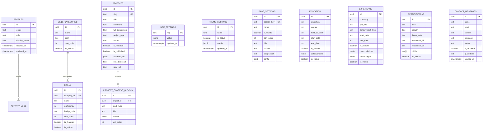

# Database Schema & Data Architecture

> **Author & Lead Software Engineer**: **Martin Wassim**  
> **Copyright**: © 2026 Martin Wassim. All rights reserved.  
> 
> This document provides a comprehensive technical reference for the database schema, table structures, relationships, Row-Level Security (RLS) policies, and migrations.

---

## 1. Database Overview

The portfolio uses **PostgreSQL 15+** managed through **Supabase**. When running in offline or demo mode, the application utilizes a structured JSON document store (`data/portfolio-store.json`) with client-side `localStorage` mirroring.



---

## 2. Table Specifications

### 2.1 `profiles`
Stores administrator and user account metadata linked to Supabase Auth (`auth.users`).
- `id` (`UUID`, Primary Key, References `auth.users(id) ON DELETE CASCADE`)
- `role` (`TEXT`, Values: `'admin'`, `'user'`, Default: `'user'`)
- `email` (`TEXT`, Not Null)
- `display_name` (`TEXT`, Default: `'Administrator'`)
- `created_at` / `updated_at` (`TIMESTAMPTZ`, Default: `NOW()`)

### 2.2 `site_settings`
Key-value configuration store for global branding, SEO defaults, contact details, and custom CSS.
- `key` (`TEXT`, Primary Key, e.g., `'general'`)
- `value` (`JSONB`, Not Null)
- `updated_at` (`TIMESTAMPTZ`)

### 2.3 `theme_settings`
Stores visual tokens (colors, gradients, border radius, glow intensity) and theme presets.
- `id` (`UUID`, Primary Key)
- `name` (`TEXT`, Default: `'Default Theme'`)
- `is_active` (`BOOLEAN`, Default: `true`)
- `config` (`JSONB`, Color codes, fonts, border radii)

### 2.4 `page_sections`
Configuration for individual homepage sections (Hero, About, Skills, Projects, etc.).
- `id` (`UUID`, Primary Key)
- `section_key` (`TEXT`, Unique, Not Null)
- `name` (`TEXT`, Not Null)
- `is_visible` (`BOOLEAN`, Default: `true`)
- `sort_order` (`INT`, Default: `0`)
- `title` (`TEXT`, Default: `''`)
- `subtitle` (`TEXT`, Default: `''`)
- `badge_text` (`TEXT`, Default: `''`)
- `config` (`JSONB`, Section-specific data, e.g., candidate name splits)

### 2.5 `skill_categories` & `skills`
Two-tier taxonomy for organizing engineering competencies.
- **`skill_categories`**:
  - `id` (`UUID`, Primary Key)
  - `name` (`TEXT`, e.g., `'Programming Languages'`, `'Frameworks & Libraries'`, `'AI & Machine Learning'`)
  - `icon` (`TEXT`, Lucide icon identifier)
  - `sort_order` (`INT`)
  - `is_visible` (`BOOLEAN`)
- **`skills`**:
  - `id` (`UUID`, Primary Key)
  - `category_id` (`UUID`, Foreign Key references `skill_categories(id) ON DELETE CASCADE`)
  - `name` (`TEXT`, e.g., `'Python'`, `'TypeScript'`, `'Flutter'`)
  - `proficiency` (`INT`, Range: `0–100`)
  - `badge_color` (`TEXT`, e.g., `'cyan'`, `'blue'`, `'purple'`, `'green'`)
  - `sort_order` (`INT`)
  - `is_featured` (`BOOLEAN`)
  - `is_visible` (`BOOLEAN`)

### 2.6 `projects` & `project_content_blocks`
In-depth case studies with structured content modules.
- **`projects`**:
  - `id` (`UUID`, Primary Key)
  - `slug` (`TEXT`, Unique, Alphanumeric slug)
  - `title` (`TEXT`, Not Null)
  - `summary` (`TEXT`)
  - `full_description` (`TEXT`, Markdown supported)
  - `project_type` (`TEXT`, e.g., `'Mobile App'`, `'Computer Vision'`, `'Full-Stack Web'`)
  - `status` (`TEXT`, e.g., `'Completed'`, `'In Progress'`)
  - `technologies` (`JSONB`, Array of strings)
  - `features` (`JSONB`, Bulleted achievements)
  - `live_demo_url` / `repo_url` (`TEXT`)
  - `is_featured` / `is_published` (`BOOLEAN`)
- **`project_content_blocks`**:
  - `id` (`UUID`, Primary Key)
  - `project_id` (`UUID`, References `projects(id) ON DELETE CASCADE`)
  - `block_type` (`TEXT`, Values: `'markdown'`, `'code_snippet'`, `'callout'`, `'metrics_grid'`)
  - `title` (`TEXT`)
  - `content` (`JSONB`)
  - `sort_order` (`INT`)

### 2.7 `certifications`
Professional credentials and licenses.
- `id` (`TEXT`, Primary Key)
- `title` (`TEXT`, Not Null)
- `issuer` (`TEXT`, Not Null)
- `issue_date` (`TEXT`)
- `credential_id` (`TEXT`)
- `credential_url` (`TEXT`)
- `skills` (`TEXT[]`)
- `is_featured` (`BOOLEAN`)
- `is_visible` (`BOOLEAN`)

### 2.8 `contact_messages`
Inquiries submitted via the public contact form.
- `id` (`UUID`, Primary Key)
- `name` / `email` / `subject` / `message` (`TEXT`, Not Null)
- `status` (`TEXT`, Values: `'unread'`, `'read'`, `'replied'`, `'archived'`, Default: `'unread'`)
- `is_archived` (`BOOLEAN`, Default: `false`)
- `ip_address` (`TEXT`)
- `created_at` (`TIMESTAMPTZ`, Default: `NOW()`)

---

## 3. Row-Level Security (RLS) Policies

All tables have RLS enabled:
```sql
ALTER TABLE public.profiles ENABLE ROW LEVEL SECURITY;
ALTER TABLE public.skills ENABLE ROW LEVEL SECURITY;
-- [Enabled on all 16 tables]
```

### Public Access Matrix
| Table | SELECT | INSERT | UPDATE | DELETE |
| :--- | :--- | :--- | :--- | :--- |
| `site_settings` | Allowed (`true`) | Denied | Denied | Denied |
| `page_sections` | Allowed (`is_visible = true`) | Denied | Denied | Denied |
| `skills` | Allowed (`is_visible = true`) | Denied | Denied | Denied |
| `projects` | Allowed (`is_published = true`) | Denied | Denied | Denied |
| `education` | Allowed (`is_visible = true`) | Denied | Denied | Denied |
| `experience` | Allowed (`is_visible = true`) | Denied | Denied | Denied |
| `certifications` | Allowed (`is_visible = true`) | Denied | Denied | Denied |
| `contact_messages` | Denied | Allowed (`WITH CHECK`) | Denied | Denied |
| `media_assets` | Allowed (`true`) | Denied | Denied | Denied |
| `activity_logs` | Denied | Denied | Denied | Denied |

### Administrator Access
Administrators verified through `public.is_admin()` have full `ALL` permissions across all tables.

---

## 4. Database Migrations

Migrations are located in `supabase/migrations/` and must be applied in sequential order:

1. `20261010000000_initial_schema.sql`: Core schema, 15 tables, RLS policies, `is_admin()` function, and the `on_auth_user_created` trigger.
2. `20261010000001_storage_setup.sql`: Storage buckets (`portfolio-media`, `portfolio-documents`) and bucket RLS policies.
3. `20261010000002_certifications.sql`: `certifications` table, indexes, and access control policies.
